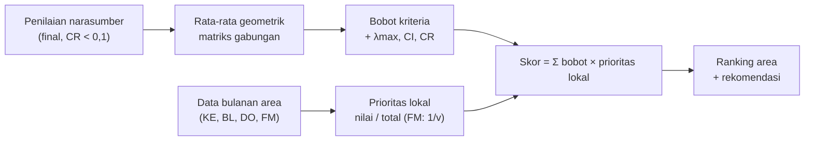

# Algoritma AHP Enerlyze

Rujukan tunggal cara kerja *Analytical Hierarchy Process* (AHP) di aplikasi Enerlyze
(Lippo Mall Puri). Isi dokumen ini diturunkan dari kode; bila ada perbedaan, kode yang
berlaku. Rujukan baris mengacu ke versi kode saat dokumen ini ditulis.

| Berkas | Isi |
|---|---|
| [`src/lib/ahp.js`](../src/lib/ahp.js) | Seluruh perhitungan AHP (fungsi murni, tanpa Firebase) |
| [`src/constants/criteria.js`](../src/constants/criteria.js) | 4 kriteria, tabel RI, `CR_THRESHOLD`, `MIN_EXPERTS`, `MAX_EXPERTS` |
| [`src/lib/recommendations.js`](../src/lib/recommendations.js) | Rekomendasi tindakan pada laporan |
| [`src/services/ahpJudgmentService.js`](../src/services/ahpJudgmentService.js) | Simpan/ambil penilaian narasumber (`ahp_judgments_enerlyze`) |
| [`src/services/ahpService.js`](../src/services/ahpService.js) | Run AHP & simpan hasil (`ahp_results_enerlyze`) |
| [`tests/ahp.test.js`](../tests/ahp.test.js) | Unit test fungsi murni (`npm test`) |

---

## a. Ringkasan metode dan alur

Tujuan: menentukan **area mana yang paling perlu dioptimalkan penggunaan energinya**.
Skor tinggi = area lebih boros / kurang terawat = prioritas optimasi lebih tinggi.

Alur dari input sampai ranking:

1. **Narasumber** (2–3 orang) mengisi 6 perbandingan berpasangan antar 4 kriteria di
   menu Master ▸ AHP. Sistem langsung menghitung matriks, bobot, λmax, CI, dan CR tiap
   narasumber. Penilaian hanya bisa disimpan `final` bila CR < 0,1; selain itu `draft`.
2. **Staff** menginput data bulanan tiap area (kWh, biaya, durasi, maintenance).
3. **Admin** menekan Run AHP pada bulan yang datanya lengkap. Sistem:
   1. mengambil penilaian berstatus `final` dan menggabungkannya dengan
      **rata-rata geometrik** per sel;
   2. menolak bila narasumber final < 2 atau > 3, atau CR gabungan ≥ 0,1, atau ada area
      tanpa data bulan itu;
   3. menghitung **bobot kriteria** dari matriks gabungan;
   4. menghitung **prioritas lokal** tiap area per kriteria dari data bulanan;
   5. menjumlahkan **skor akhir** = Σ bobot × prioritas lokal, lalu mengurutkan;
   6. menyimpan *snapshot* hasil ke `ahp_results_enerlyze/<YYYY-MM>` dengan
      `weight_source = "expert_pairwise"` dan daftar `experts`.
4. Laporan Detail menampilkan matriks gabungan, ranking, kontribusi kriteria, dan
   rekomendasi untuk 2 area teratas.



---

## b. Hierarki

| Level | Isi |
|---|---|
| Tujuan | Prioritas area yang paling perlu dioptimalkan penggunaan energinya |
| Kriteria | 4 kriteria tetap (tidak bisa ditambah/dihapus) — tabel di bawah |
| Alternatif | Semua area di `areas_enerlyze` (contoh: BS, LG, GF, UG, 1F, 2F) |

Kriteria ([`criteria.js`](../src/constants/criteria.js), urutan array = urutan baris/kolom matriks):

| Kode | Kriteria | Satuan | Definisi operasional | Arah dalam skor |
|---|---|---|---|---|
| KE | Konsumsi Energi | kWh per bulan | Total energi listrik yang terpakai di area | Lebih tinggi → prioritas lebih tinggi |
| BL | Biaya Listrik | Rp per bulan | Biaya pemakaian listrik area | Lebih tinggi → prioritas lebih tinggi |
| DO | Durasi Operasional | jam per bulan | Lamanya peralatan beroperasi dalam satu bulan | Lebih tinggi → prioritas lebih tinggi |
| FM | Frekuensi Maintenance | kali per bulan | Seberapa sering perawatan dilakukan | **Dibalik**: lebih rendah → prioritas lebih tinggi |

Dari sudut pandang efisiensi, KE/BL/DO adalah kriteria *cost* (makin besar makin buruk) dan
FM adalah kriteria *benefit* (makin sering dirawat makin baik). Karena skor Enerlyze mengukur
"perlu dioptimalkan", nilai KE/BL/DO dipakai apa adanya dan FM dibalik (`higherIsWorse: false`).
Alasan pembalikan menurut kode: frekuensi rendah = area kurang terawat = berpotensi lebih boros.

> Catatan: teks `description` DO di `criteria.js` masih menyebut "setiap harinya", sedangkan
> data yang diinput (form "Durasi Operasional (jam)") dan data contoh bernilai jam per bulan
> (mis. 720 = 24 × 30). Dokumen ini memakai jam per bulan.

---

## c. Skala Saaty dan matriks perbandingan berpasangan

Nilai yang boleh dipakai ([`SAATY_VALUES`](../src/lib/ahp.js#L23), [`isSaatyValue`](../src/lib/ahp.js#L32)):
`1/9, 1/8, …, 1/2, 1, 2, …, 9` (17 nilai; perbandingan float memakai toleransi 1e-9).

| Nilai | Arti (label di UI) |
|---|---|
| 1 | sama penting |
| 3 | sedikit lebih penting |
| 5 | lebih penting |
| 7 | sangat lebih penting |
| 9 | mutlak lebih penting |
| 2, 4, 6, 8 | nilai antara |

Setiap narasumber mengisi 6 pasangan `{ a, b, value }` dengan `a` sebelum `b` dalam urutan
KE, BL, DO, FM: KE–BL, KE–DO, KE–FM, BL–DO, BL–FM, DO–FM.
Konvensi nilai: `value = n` bila **a** lebih penting n kali; `value = 1/n` bila **b** lebih penting.

[`buildMatrixFromPairs`](../src/lib/ahp.js#L62) membentuk matriks n×n:

```
a_ii = 1
a_ij = value          (untuk pasangan a=i, b=j, i < j)
a_ji = 1 / a_ij       (resiprokal)
```

Pasangan yang diberikan terbalik `(b, a)` otomatis dibalik nilainya. Fungsi melempar error bila
kode kriteria tidak dikenal, nilai di luar skala Saaty, pasangan diisi dua kali, atau jumlah
pasangan ≠ n(n−1)/2 = 6.

---

## d. Penggabungan, bobot, dan konsistensi

### Rata-rata geometrik (AIJ)

[`geometricMeanMatrix`](../src/lib/ahp.js#L98) menggabungkan matriks k narasumber **final** sel per sel:

```
g_ij = ( a_ij^(1) × a_ij^(2) × … × a_ij^(k) )^(1/k)      untuk i < j
     = exp( (1/k) Σ_m ln a_ij^(m) )                       (cara hitung di kode)
g_ji = 1 / g_ij,   g_ii = 1
```

Segitiga bawah diisi resiprokal persis dari segitiga atas, sehingga hasilnya tetap resiprokal.

### Bobot (aproksimasi eigenvector)

[`priorityVector`](../src/lib/ahp.js#L175):

```
s_j  = Σ_i a_ij                 (jumlah kolom)
n_ij = a_ij / s_j               (normalisasi kolom)
w_i  = (1/n) Σ_j n_ij           (rata-rata baris = bobot)
```

### λmax, CI, CR

[`consistency`](../src/lib/ahp.js#L191):

```
λmax = (1/n) Σ_i ( (A·w)_i / w_i )
CI   = (λmax − n) / (n − 1)
CR   = CI / RI(n)
```

Tabel RI di kode (`RANDOM_INDEX`, [`criteria.js:63`](../src/constants/criteria.js#L63)):

| n | 1 | 2 | 3 | 4 | 5 |
|---|---|---|---|---|---|
| RI | 0 | 0 | 0,58 | **0,90** | 1,12 |

Untuk n < 3 fungsi mengembalikan CR = 0; untuk n > 5 kode memakai RI = 1,12. Enerlyze selalu n = 4,
jadi RI = 0,90. Matriks dianggap konsisten bila **CR < 0,1** (`CR_THRESHOLD`).

### Perilaku saat CR ≥ 0,1

| Tempat | Perilaku |
|---|---|
| Form narasumber (Master ▸ AHP) | Peringatan "CR … ≥ 0.1: penilaian belum konsisten", 2 pasangan paling tidak konsisten, tombol **Simpan final nonaktif**; hanya **Simpan draft**. Service juga menolak `final` ([`toJudgmentFields`](../src/lib/ahp.js#L255)). |
| Run AHP | [`expertWeightsBlocker`](../src/lib/ahp.js#L321) menolak bila narasumber final < 2 (`MIN_EXPERTS`), > 3 (`MAX_EXPERTS`), atau CR gabungan ≥ 0,1, dengan pesan yang mengarahkan ke menu Master > AHP. Kelengkapan data area dicek terpisah di [`runAndSaveAHP`](../src/services/ahpService.js#L54). |

### Pasangan paling tidak konsisten

[`inconsistentPairs`](../src/lib/ahp.js#L223) membandingkan setiap penilaian `a_ij` (i < j) dengan
rasio yang tersirat dari bobot `w_i / w_j`, pada skala log agar 3 vs 1/3 setara:

```
deviasi_ij = | ln a_ij − ln (w_i / w_j) |
saran_ij   = nilai Saaty terdekat dengan w_i / w_j (juga pada skala log)
```

Daftar diurutkan dari deviasi terbesar; UI menampilkan 2 teratas ("saat ini x, yang selaras
dengan bobot ≈ y").

---

## e. Prioritas alternatif (lokal)

Alternatif **tidak** dibandingkan berpasangan. Prioritas lokal dihitung langsung dari data
bulanan ([`priorityValue`](../src/lib/ahp.js#L344) & [`runAHP`](../src/lib/ahp.js#L359)):

```
x = Number(nilai_mentah) || 0
pv = x                         untuk KE, BL, DO
pv = 1 / x                     untuk FM, bila x > 0
pv = 1 / 0,5 = 2               untuk FM, bila x = 0 (atau kosong) → diperlakukan 0,5 kali/bulan

lp(area, k) = pv(area, k) / Σ_area pv(·, k)          (normalisasi setelah pembalikan)
lp(area, k) = 1 / jumlah_area                        bila Σ pv = 0
```

Ini adalah varian **AHP *absolute measurement* / *ratings***: setara dengan matriks perbandingan
alternatif yang konsisten sempurna `a_ij = pv_i / pv_j`, sehingga CR alternatif = 0 dan tidak
dihitung.

---

## f. Skor akhir dan pemeringkatan

```
kontribusi(area, k) = w_k × lp(area, k)        → disimpan sebagai ranking[].breakdown
skor(area)          = Σ_k kontribusi(area, k)  → Σ skor seluruh area = 1
```

- **Interpretasi**: skor tinggi = area lebih perlu dioptimalkan.
- **Pemeringkatan**: diurutkan menurun berdasarkan skor, `rank = 1, 2, …` tanpa rank kembar.
- **Tie-break**: tidak eksplisit. `Array.prototype.sort` bersifat stabil, sehingga skor sama
  mempertahankan urutan masukan `areas`, yaitu **urutan nama area** (`localeCompare`,
  [`areaService.js:15`](../src/services/areaService.js#L15); `scripts/run-ahp.mjs` memakai urutan yang sama).
- Hasil adalah *snapshot*: perubahan data, area, atau penilaian narasumber setelah Run AHP
  tidak mengubah hasil tersimpan sampai admin menjalankan Re-run AHP.

---

## g. Rekomendasi tindakan

[`buildRecommendation`](../src/lib/recommendations.js#L45) dipanggil untuk **2 area teratas** di laporan.

1. Kriteria diurutkan berdasarkan kontribusi (`breakdown`) terbesar.
2. Kriteria ke-1 mengambil template indeks 0, ke-2 indeks 1, ke-3 indeks 2
   (`actions.length % pool.length`), sampai ada 3 aksi.
3. Bila tidak ada aksi yang memuat kata "maintenance", aksi ke-3 diganti
   "Tingkatkan frekuensi maintenance dari 1x → 2x per bulan." (kondisi ini hampir selalu terpenuhi
   karena `breakdown` selalu memuat FM).
4. Potensi penghematan hanya bergantung pada skor:

| Skor | Teks |
|---|---|
| ≥ 0,30 | ~12–15% konsumsi bulanan |
| ≥ 0,22 | ~8–10% konsumsi bulanan |
| ≥ 0,15 | ~5–7% konsumsi bulanan |
| lainnya | ~3–5% konsumsi bulanan |

**Isi rekomendasi adalah template tetap di kode tanpa rujukan standar** (mis. SNI, ASHRAE, atau
regulasi), termasuk angka 24 °C, LED 9 W, "1x → 2x", dan persentase penghematan. Saran
maintenance tidak memperhitungkan frekuensi aktual area. Ambang penghematan memakai skor relatif
(Σ skor = 1), sehingga dipengaruhi jumlah area.

Contoh 2026-05: 2F (skor 0,2215; urutan kontribusi KE > BL > FM > DO) dan LG (0,2010; BL > KE > DO > FM)
mendapat aksi pertama berbeda, tetapi aksi ke-3 keduanya sama ("Tingkatkan frekuensi maintenance
dari 1x → 2x per bulan.") walaupun maintenance 2F = 1x dan LG = 2x. Penghematan: 2F "~8–10%", LG "~5–7%".

---

## h. Perbedaan dengan AHP klasik dan keterbatasan

| Topik | Enerlyze | AHP klasik (Saaty) |
|---|---|---|
| Perbandingan alternatif | Tidak ada; prioritas lokal = normalisasi nilai data (*absolute measurement*) | Matriks berpasangan per kriteria untuk alternatif |
| Bobot | Aproksimasi (normalisasi kolom + rata-rata baris) | Eigenvector utama |
| Penggabungan narasumber | Rata-rata geometrik penilaian individual (AIJ), hanya penilaian final | Sama (AIJ) atau agregasi prioritas (AIP) |
| CR ≥ 0,1 | Narasumber hanya boleh simpan draft; Run AHP ditolak bila CR gabungan ≥ 0,1 | Penilaian direvisi |

Keterbatasan:

- **Luas area tidak dipakai.** `energy_area_m2` diinput tetapi tidak masuk perhitungan, sehingga
  area besar cenderung mendapat skor tinggi karena ukurannya; intensitas (kWh/m²) tidak diukur.
- **KE dan BL berkorelasi kuat** (biaya ≈ kWh × tarif), sehingga besaran yang sama ikut dihitung dua kali;
  pada contoh 2026-05 bobot gabungan keduanya ≈ 0,80.
- **Nilai 0 pada FM diperlakukan 0,5 kali/bulan** — keputusan desain, bukan bagian AHP.
- **Skor relatif per bulan** (Σ = 1): tidak dapat dibandingkan langsung antarbulan bila jumlah area berubah.
- **Snapshot** tidak diperbarui otomatis bila data, area, atau penilaian narasumber berubah.
- **Input bilangan bulat** (form hanya menerima digit), jadi nilai desimal tidak dapat diinput.
- **Hasil lama** (sebelum fitur narasumber) tidak punya `weight_source`/`experts`; bobotnya dibentuk
  dari rank kriteria (`buildCriteriaMatrix`, kini *deprecated*) dan CR-nya selalu 0,0439.

---

## i. Contoh perhitungan lengkap — Mei 2026

> **Sumber data**: dibaca (tanpa menulis) dari `ahp_results_enerlyze/2026-05` (Run AHP oleh
> "Admin", 13 Okt 2026), dua dokumen `ahp_judgments_enerlyze` yang dirujuk hasil tersebut, dan
> 6 dokumen `data_enerlyze` bulan 2026-05. Seluruh langkah dihitung ulang dengan fungsi murni
> `src/lib/ahp.js` lewat Node; **semua nilai identik** dengan yang tersimpan (selisih maksimum
> 8,9 × 10⁻¹⁶, galat pembulatan floating-point). Angka ditampilkan 4 desimal.
>
> ⚠️ Narasumber berlabel **"(contoh)"** dan data energi Mei adalah **data contoh** yang dibuat
> dengan `scripts/seed-may-data.mjs`, bukan hasil wawancara atau pengukuran nyata.

### i.1 Penilaian tiap narasumber

**Narasumber Contoh 1 (contoh)** — Chief Engineering (contoh), status `final`

| Pasangan | Nilai tersimpan | Arti |
|---|---|---|
| KE vs BL | 2 | KE lebih penting (2) |
| KE vs DO | 4 | KE lebih penting (4) |
| KE vs FM | 6 | KE lebih penting (6) |
| BL vs DO | 2 | BL lebih penting (2) |
| BL vs FM | 4 | BL lebih penting (4) |
| DO vs FM | 2 | DO lebih penting (2) |

|  | KE | BL | DO | FM |
|---|---|---|---|---|
| **KE** | 1 | 2 | 4 | 6 |
| **BL** | 1/2 | 1 | 2 | 4 |
| **DO** | 1/4 | 1/2 | 1 | 2 |
| **FM** | 1/6 | 1/4 | 1/2 | 1 |

Bobot KE = 0,5125 · BL = 0,2755 · DO = 0,1377 · FM = 0,0743 · λmax = 4,0104 · CI = 0,0035 · CR = 0,0038

**Narasumber Contoh 2 (contoh)** — Kepala Operasional (contoh), status `final`

| Pasangan | Nilai tersimpan | Arti |
|---|---|---|
| KE vs BL | 1/2 | BL lebih penting (2) |
| KE vs DO | 3 | KE lebih penting (3) |
| KE vs FM | 5 | KE lebih penting (5) |
| BL vs DO | 5 | BL lebih penting (5) |
| BL vs FM | 7 | BL lebih penting (7) |
| DO vs FM | 2 | DO lebih penting (2) |

|  | KE | BL | DO | FM |
|---|---|---|---|---|
| **KE** | 1 | 1/2 | 3 | 5 |
| **BL** | 2 | 1 | 5 | 7 |
| **DO** | 1/3 | 1/5 | 1 | 2 |
| **FM** | 1/5 | 1/7 | 1/2 | 1 |

Bobot KE = 0,3009 · BL = 0,5254 · DO = 0,1104 · FM = 0,0634 · λmax = 4,0201 · CI = 0,0067 · CR = 0,0075

Keduanya CR < 0,1 sehingga boleh berstatus final, dan jumlahnya memenuhi `MIN_EXPERTS` = 2.

### i.2 Matriks gabungan (rata-rata geometrik, k = 2)

| Sel | Narasumber 1 | Narasumber 2 | Rata-rata geometrik |
|---|---|---|---|
| KE–BL | 2 | 1/2 | √(2 × 1/2) = 1,0000 |
| KE–DO | 4 | 3 | √(4 × 3) = 3,4641 |
| KE–FM | 6 | 5 | √(6 × 5) = 5,4772 |
| BL–DO | 2 | 5 | √(2 × 5) = 3,1623 |
| BL–FM | 4 | 7 | √(4 × 7) = 5,2915 |
| DO–FM | 2 | 2 | √(2 × 2) = 2,0000 |

|  | KE | BL | DO | FM |
|---|---|---|---|---|
| **KE** | 1,0000 | 1,0000 | 3,4641 | 5,4772 |
| **BL** | 1,0000 | 1,0000 | 3,1623 | 5,2915 |
| **DO** | 0,2887 | 0,3162 | 1,0000 | 2,0000 |
| **FM** | 0,1826 | 0,1890 | 0,5000 | 1,0000 |
| **Jumlah kolom** | **2,4712** | **2,5052** | **8,1264** | **13,7687** |

### i.3 Matriks ternormalisasi dan bobot

|  | KE | BL | DO | FM | Jumlah baris | Bobot (÷ 4) |
|---|---|---|---|---|---|---|
| **KE** | 0,4047 | 0,3992 | 0,4263 | 0,3978 | 1,6279 | **0,4070** |
| **BL** | 0,4047 | 0,3992 | 0,3891 | 0,3843 | 1,5773 | **0,3943** |
| **DO** | 0,1168 | 0,1262 | 0,1231 | 0,1453 | 0,5114 | **0,1278** |
| **FM** | 0,0739 | 0,0754 | 0,0615 | 0,0726 | 0,2835 | **0,0709** |

### i.4 λmax, CI, CR

| Kriteria | (A·w)ᵢ | wᵢ | (A·w)ᵢ / wᵢ |
|---|---|---|---|
| KE | 1,6323 | 0,4070 | 4,0108 |
| BL | 1,5806 | 0,3943 | 4,0083 |
| DO | 0,5118 | 0,1278 | 4,0031 |
| FM | 0,2836 | 0,0709 | 4,0019 |

λmax = 4,0060 · CI = (4,0060 − 4) / 3 = 0,0020 · CR = 0,0020 / 0,90 = **0,0022** (< 0,1 → konsisten;
`expertWeightsBlocker` mengembalikan `null`, Run AHP diizinkan).

### i.5 Data input Mei 2026

| Area | KE (kWh) | BL (Rp) | DO (jam/bulan) | FM (x/bulan) | Luas (m²)* |
|---|---|---|---|---|---|
| 1F | 114.600 | 163.024.000 | 351 | 3 | 7.500 |
| 2F | 155.600 | 219.986.000 | 390 | 1 | 9.000 |
| BS | 86.100 | 129.565.000 | 720 | 3 | 15.000 |
| GF | 106.200 | 152.762.000 | 339 | 5 | 7.000 |
| LG | 140.700 | 225.418.000 | 383 | 2 | 8.500 |
| UG | 95.200 | 140.470.000 | 355 | 4 | 6.500 |

\* Luas tidak dipakai dalam perhitungan. Urutan baris = urutan nama area (urutan masukan `runAHP`).

### i.6 Prioritas lokal

| Area | lp KE | lp BL | lp DO | FM: v → 1/v | lp FM |
|---|---|---|---|---|---|
| 1F | 0,1641 | 0,1581 | 0,1383 | 3 → 0,3333 | 0,1274 |
| 2F | 0,2228 | 0,2133 | 0,1537 | 1 → 1,0000 | 0,3822 |
| BS | 0,1233 | 0,1256 | 0,2837 | 3 → 0,3333 | 0,1274 |
| GF | 0,1521 | 0,1481 | 0,1336 | 5 → 0,2000 | 0,0764 |
| LG | 0,2015 | 0,2186 | 0,1509 | 2 → 0,5000 | 0,1911 |
| UG | 0,1363 | 0,1362 | 0,1399 | 4 → 0,2500 | 0,0955 |

Total pembagi: KE = 698.400 · BL = 1.031.225.000 · DO = 2.538 · FM (Σ 1/v) = 2,6167.
Contoh: lp KE 2F = 155.600 / 698.400 = 0,2228; lp FM 2F = 1,0000 / 2,6167 = 0,3822.

### i.7 Kontribusi, skor, dan ranking

| Rank | Area | KE (× 0,4070) | BL (× 0,3943) | DO (× 0,1278) | FM (× 0,0709) | Skor |
|---|---|---|---|---|---|---|
| 1 | 2F | 0,0907 | 0,0841 | 0,0196 | 0,0271 | **0,2215** |
| 2 | LG | 0,0820 | 0,0862 | 0,0193 | 0,0135 | **0,2010** |
| 3 | 1F | 0,0668 | 0,0623 | 0,0177 | 0,0090 | **0,1558** |
| 4 | BS | 0,0502 | 0,0495 | 0,0363 | 0,0090 | **0,1450** |
| 5 | GF | 0,0619 | 0,0584 | 0,0171 | 0,0054 | **0,1428** |
| 6 | UG | 0,0555 | 0,0537 | 0,0179 | 0,0068 | **0,1338** |

Σ skor = 1,0000. Tidak ada skor kembar, sehingga tie-break tidak berperan.
Contoh: skor 2F = 0,4070 × 0,2228 + 0,3943 × 0,2133 + 0,1278 × 0,1537 + 0,0709 × 0,3822 = 0,2215.

**Interpretasi**: 2F adalah area dengan prioritas optimasi tertinggi pada Mei 2026, terutama karena
konsumsi energi dan biayanya terbesar serta frekuensi maintenance-nya paling rendah (1x/bulan).
